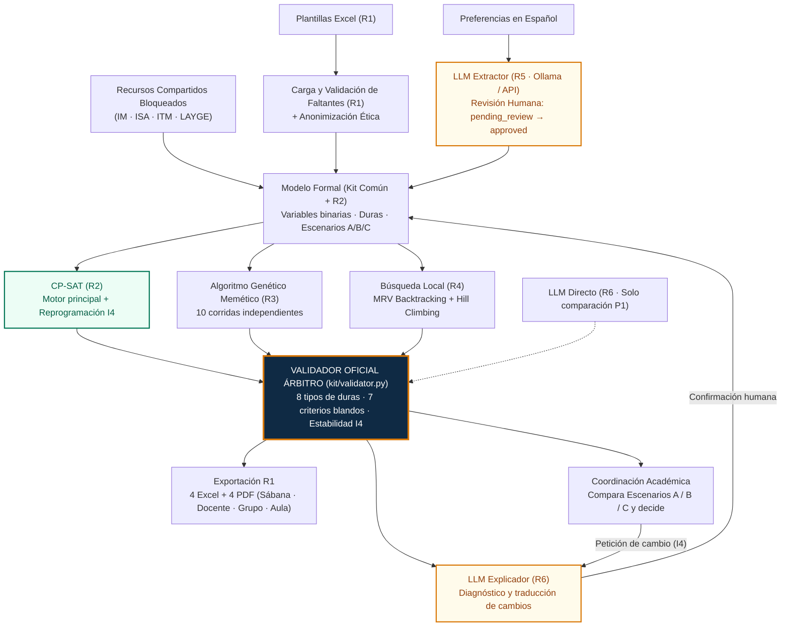
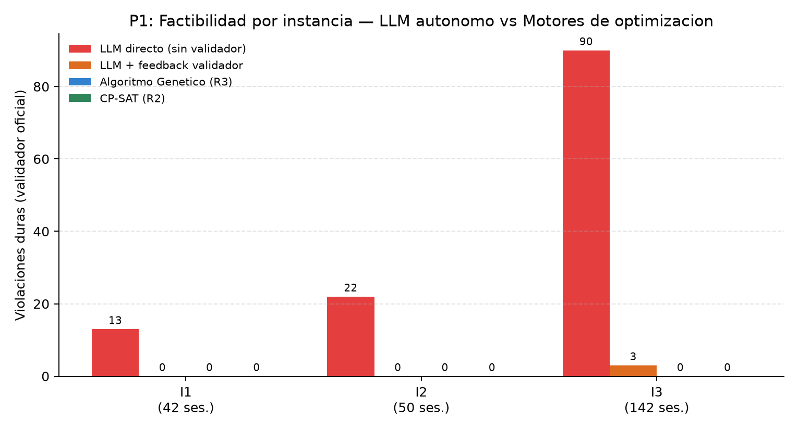
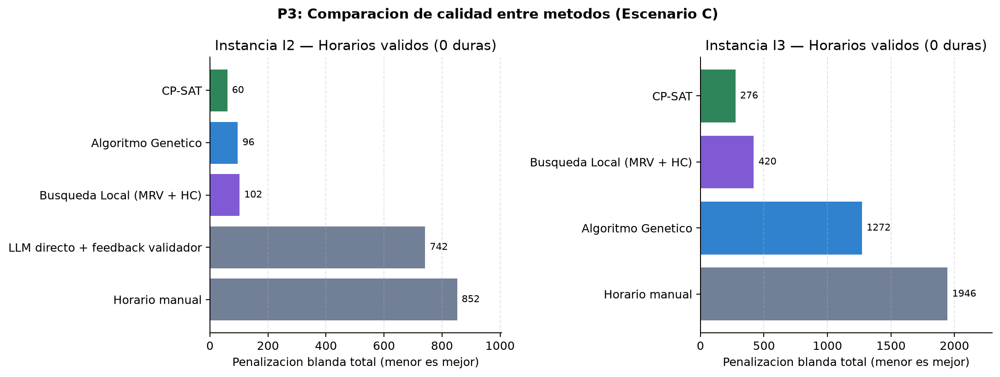
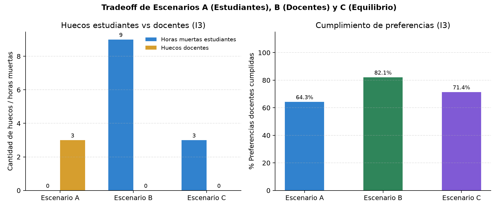
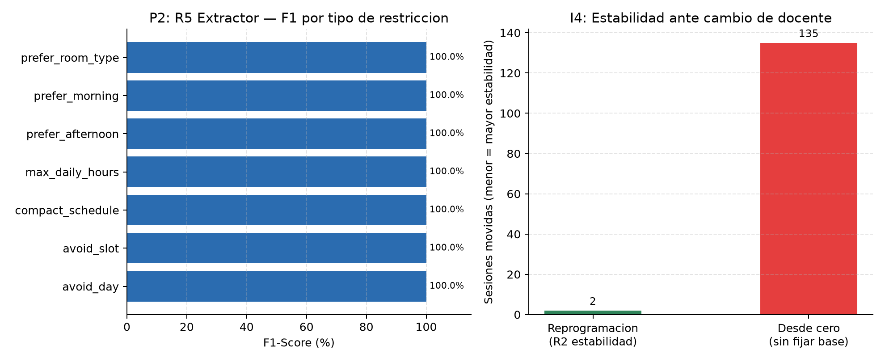
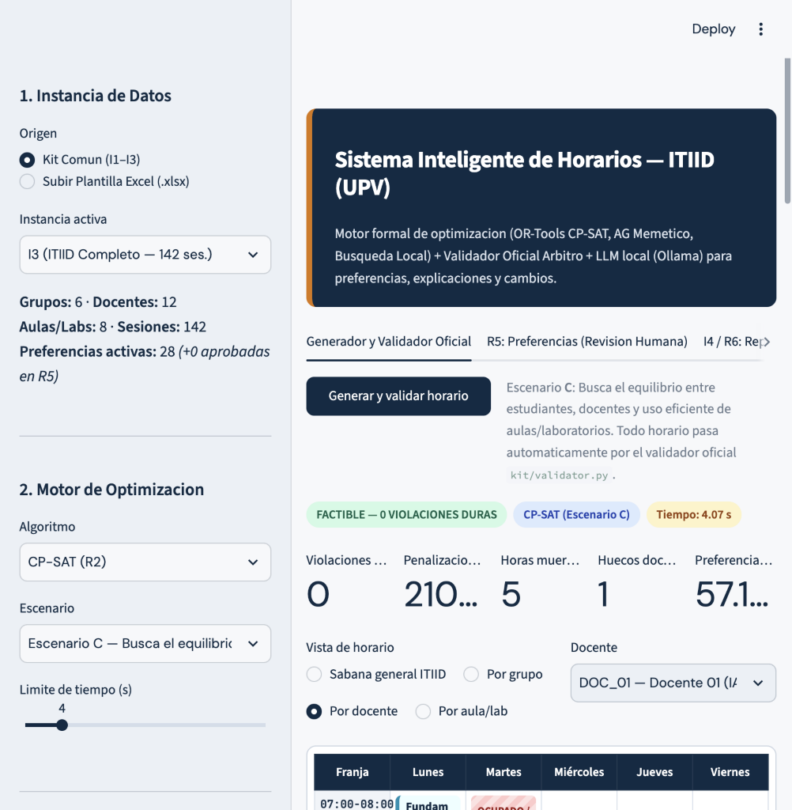

<div align="center">



<br/><br/>

[](https://github.com/Davsalazardev/FHorario/actions/workflows/ci.yml)


<p align="center">
  <a href="#-arquitectura-del-sistema">Arquitectura</a> ·
  <a href="#-resultados-experimentales-p1p4">Resultados P1–P4</a> ·
  <a href="#-consola-interactiva-en-streamlit">Vista en Vivo</a> ·
  <a href="#-guia-rapida-de-ejecucion">Ejecución</a> ·
  <a href="#-documentacion-y-entregables">Entregables</a>
</p>

</div>

> [!IMPORTANT]
> **Regla central de diseño:** Las asignaciones las decide un **motor formal de optimización** (`OR-Tools CP-SAT`, `Algoritmo Genético Memético` o `Búsqueda Local`) y las revisa el **validador oficial árbitro** (`kit/validator.py`). **El LLM nunca decide solo**: se usa exclusivamente para extraer preferencias escritas en español (con revisión humana obligatoria), explicar conflictos y traducir cambios de reprogramación.

---

## Resumen de Resultados Clave

| Dimensión | Evidencia Medida | Método / Backend |
| :--- | :--- | :--- |
| **Factibilidad (`I1`, `I2`, `I3`, `I4`)** | **0 violaciones duras** en todas las instancias (`30/30` corridas AG factibles) | `CP-SAT` · `AG Memético` · `Búsqueda Local` |
| **Calidad vs Horario Manual (`I3`)** | **84.0% menos penalización** (`312 pts` vs `1946 pts` manual) | `CP-SAT (Escenario C, 6 s)` |
| **Estabilidad en Reprogramación (`I4`)** | **98.59% estabilidad** — solo **2 / 142 sesiones** movidas en `0.63 s` | `R2 Reprogramación` + `R6 qwen2.5:7b` |
| **Extracción de Preferencias (`P2`)** | **Precisión `1.000` · Recall `1.000` · F1 `1.000`** (25 frases, 7 tipos) | `ollama:qwen2.5:7b` (en vivo) |
| **LLM Autónomo sin Solver (`P1`)** | **135 violaciones duras** en `I3` (`116` aún con feedback del validador) | `ollama:qwen2.5:7b` (confirma Alharbi, 2026) |

---

## Arquitectura del Sistema

El alcance es **por programa académico (ITIID)** y no por toda la universidad: docentes, aulas y laboratorios compartidos con otros programas (`IM`, `ISA`, `ITM`, `LAYGE`) se modelan como **franjas previamente ocupadas**.



<details>
<summary><b>Ver mapa de módulos y responsabilidades (Kit Común + Roles R1–R6)</b></summary>

| Módulo | Ruta | Responsabilidad |
| :--- | :--- | :--- |
| **Kit Común** | [`kit/`](kit/) | Esquema JSON único (`schema.py`), validador árbitro (`validator.py`), CP-SAT base (`cpsat_base.py`), parser ITC-2007 multi-curriculum (`instances.py`) y 25 preferencias anotadas (`preferences_dataset.py`). |
| **`R1` Datos y Exportación** | [`src/r1_data/`](src/r1_data/) | Plantillas Excel, validación de faltantes (`ExcelValidationError`), anonimizador ético (`anonymizer.py`) y exportación a **Excel y PDF** por sábana general, docente, grupo y aula. |
| **`R2` Modelo CP-SAT** | [`src/r2_cpsat/`](src/r2_cpsat/) | Extiende el kit base con penalizaciones blandas linealizadas exactas (verificadas 1-a-1 contra el validador), Escenarios **A / B / C** y reprogramación **I4**. |
| **`R3` Algoritmo Genético** | [`src/r3_genetic/`](src/r3_genetic/) | AG Memético con cruce por bloques de grupo, reparación `Min-Conflicts`, pulido local ajustado (`pop=32, polish=8`) y **10 corridas por instancia**. |
| **`R4` Búsqueda Local** | [`src/r4_local_search/`](src/r4_local_search/) | Backtracking con heurística **MRV** + grado, reparación `Min-Conflicts` y *Hill Climbing* con reinicios aleatorios (movimientos + *swaps* 2-opt). |
| **`R5` LLM Extractor** | [`src/r5_llm_extractor/`](src/r5_llm_extractor/) | Prompts en español $\rightarrow$ JSON con estado obligatorio `pending_review`, soporte **Ollama / Gemini / OpenAI / offline** y evaluador P/R/F1 por tipo. |
| **`R6` LLM Explicador** | [`src/r6_llm_explainer/`](src/r6_llm_explainer/) | Experimento `P1` (LLM directo con/sin feedback), explicador de conflictos para coordinación (`P4`) y traductor de cambios (`I4`). |

</details>

---

## Resultados Experimentales (P1–P4)

Todas las gráficas corresponden a corridas reales con **`ollama:qwen2.5:7b`** y motores evaluados bajo el mismo límite de tiempo (`3.0 s` por corrida en tabla de posiciones; `6.0 s` en Escenarios `A`/`B`/`C` e `I4`):

<table>
  <tr>
    <td width="50%" align="center">
      <b>P1: LLM Autónomo vs Motores Formales</b><br/>
      
    </td>
    <td width="50%" align="center">
      <b>P3: Comparación de Calidad (Escenario C)</b><br/>
      
    </td>
  </tr>
  <tr>
    <td width="50%" align="center">
      <b>Escenarios A (Estudiantes), B (Docentes) y C (Equilibrio)</b><br/>
      
    </td>
    <td width="50%" align="center">
      <b>P2 (F1 por tipo en R5) + Estabilidad I4</b><br/>
      
    </td>
  </tr>
</table>

<details>
<summary><b>Ver Tabla de Posiciones Oficial (I1, I2 e I3 — Escenario C)</b></summary>

| Instancia | 1.º Lugar | 2.º Lugar | 3.º Lugar | Horario Manual | LLM directo (`qwen2.5:7b`) |
| :---: | :--- | :--- | :--- | :--- | :--- |
| **`I1`** *(42 ses.)* | **CP-SAT:** `0` duras · `0 pts` (`0.24 s`) | **Búsqueda Local:** `0` duras · `0 pts` | **AG (10/10):** `0` duras · `0 pts` | — | ❌ `10` duras (`15` c/ feedback) |
| **`I2`** *(50 ses.)* | **CP-SAT:** `0` duras · `60 pts` (`2.48 s`) | **AG (10/10):** `0` duras · `108 pts` | **Búsqueda Local:** `0` duras · `138 pts` | `0` duras · `852 pts` | ❌ `29` duras (`26/50` ses.) |
| **`I3`** *(142 ses.)* | **AG (10/10, 3 s):** `0` duras · `408 pts` | **CP-SAT (3 s):** `0` duras · `412 pts` *(`312` en 6 s)* | **Búsqueda Local:** `0` duras · `488 pts` | `0` duras · `1946 pts` | ❌ `135` duras (`116` c/ feedback) |

Ver CSV completo en [`results/leaderboard.csv`](results/leaderboard.csv).

</details>

<details>
<summary><b>Ver Experimento de Ajuste de Hiperparámetros del Algoritmo Genético (R3)</b></summary>

Barrido sobre `I2` e `I3` (3 semillas por configuración, `2.5 s` por corrida):

| Configuración `R3` | `pop_size` | `mut_rate` | `polish_steps` | `I2` Media | `I3` Mejor | `I3` Media | Factibles |
| :--- | :-: | :-: | :-: | :-: | :-: | :-: | :-: |
| AG-Base (sin pulido) | 28 | 0.35 | 0 | 144.7 | 666 | 731.3 | 100% |
| **AG-PobGrande (seleccionado)** | **32** | **0.30** | **8** | **126.0** | **464** | **524.0** | **100%** |
| AG-Balanceado | 18 | 0.40 | 18 | 136.0 | 988 | 1116.7 | 100% |
| AG-Intensivo | 14 | 0.45 | 28 | 134.7 | 558 | 675.3 | 100% |

Ver JSON completo en [`results/tuning_results.json`](results/tuning_results.json).

</details>

---

## Consola Interactiva en Streamlit

Interfaz conectada nativamente a **Ollama local (`qwen2.5:7b` / `dolphin3`)** con flujo completo **Human-in-the-Loop**:
- Grilla horaria HTML codificada por color por materia y bloques `OCUPADO / NO DISP.` en rojo rayado (sábana general, grupo, docente y aula).
- Bandeja **`R5`** con botones **Aprobar / Rechazar** que inyectan restricciones validadas directo al motor.
- Reprogramación **`I4`** en 2 pasos (**Traducir con `R6`** $\rightarrow$ **Confirmar y Reprogramar con `R2`**) + descarga en 1 clic de los 4 Excel y 4 PDF.

<p align="center">
  
</p>

---

## Guía Rápida de Ejecución

```bash
# 1. Clonar e instalar dependencias (Python 3.11+)
git clone https://github.com/Davsalazardev/FHorario.git
cd FHorario
python3.11 -m venv .venv && source .venv/bin/activate
pip install -r requirements.txt

# 2. Correr suite completa de pruebas (10/10)
pytest -v

# 3. Abrir la consola web interactiva (detecta Ollama automaticamente)
streamlit run app.py
```

<details>
<summary><b>Comandos avanzados de CLI (Benchmark, Tuning, Ollama y API externa)</b></summary>

```bash
# Ejecutar benchmark oficial completo (I1-I4, 10 corridas AG, graficas, Excel y PDF)
python main.py benchmark --time-limit 3.0 --ga-runs 10 --provider offline

# Ejecutar evaluacion real con Ollama local (qwen2.5:7b) para P1, P2 y P4
python -m src.evaluation.run_ollama_eval --model qwen2.5:7b

# Correr ajuste de hiperparametros del Algoritmo Genetico
python main.py tune-ga --time-limit 2.5

# Evaluar R5 con API externa (Gemini) o modelo local (Ollama)
export GEMINI_API_KEY="tu_clave"
python main.py eval-r5 --provider gemini
python main.py eval-r5 --provider ollama --model qwen2.5:7b

# Resolver una instancia o plantilla Excel especifica y exportar 4 Excel + 4 PDF
python main.py solve --instance I3 --method cpsat --scenario C --time-limit 10
```

</details>

---

## Documentación y Entregables

| Entregable | Archivo | Descripción |
| :--- | :--- | :--- |
| **Informe de Diseño** | [`docs/01_informe_diseno.md`](docs/01_informe_diseno.md) | Formulación formal, lógica proposicional, función objetivo, marco teórico (`Alharbi 2026`, `MIWAI 2025`, `TRACE-cs 2024`) y análisis ético. |
| **Informe de Implementación** | [`docs/02_informe_implementacion.md`](docs/02_informe_implementacion.md) | Arquitectura del repositorio, decisiones técnicas `R1`–`R6`, Ollama/API y guía de ejecución. |
| **Informe de Evaluación (`P1`–`P4`)** | [`docs/03_informe_evaluacion.md`](docs/03_informe_evaluacion.md) | Resultados completos, ajuste de AG, tabla de posiciones y respuestas sustentadas a `P1`–`P4`. |
| **Presentación Ejecutiva (PDF 16:9)** | [`docs/presentacion_horarios_itiid.pdf`](docs/presentacion_horarios_itiid.pdf) | 8 diapositivas listas para presentar con gráficas reales y guion en [`docs/04_presentacion_final.md`](docs/04_presentacion_final.md). |
| **Rúbrica Cualitativa `P4`** | [`docs/05_rubrica_evaluacion_p4.md`](docs/05_rubrica_evaluacion_p4.md) | Instrumento Likert 1–5 para coordinación académica y equipos pares durante la demo en vivo. |
| **Paquetes Excel y PDF (`I3`)** | [`results/exports/I3_excel/`](results/exports/I3_excel/) · [`results/exports/I3_pdf/`](results/exports/I3_pdf/) | Sábana general de ITIID, por docente, por grupo y por aula/laboratorio. |
| **Plantillas Excel Oficiales** | [`data/templates/`](data/templates/) | Plantillas listas para capturar datos reales de ITIID (`I2` e `I3`). |

---

<div align="center">
  <sub>Universidad Politécnica de Victoria · Ingeniería en Tecnologías de la Información e Innovación Digital (ITIID) · Fundamentos de IA (E-FIA-3)</sub>
</div>
