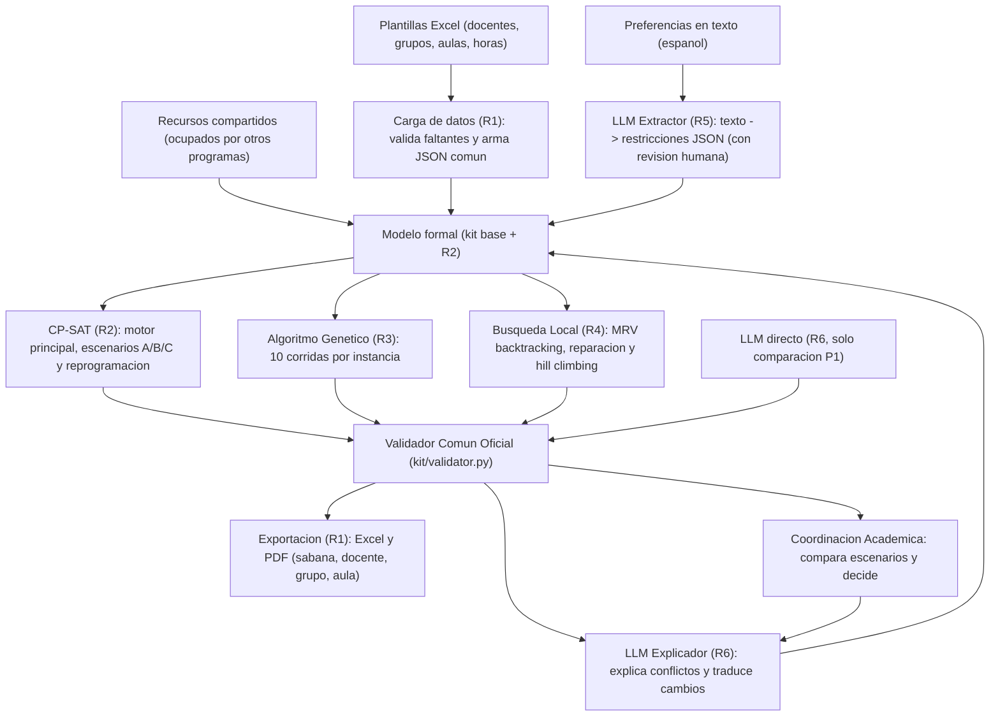

# Informe de Diseño — Sistema Inteligente para la Generación de Horarios de ITIID

**Asignatura:** Fundamentos de Inteligencia Artificial (E-FIA-3, 7.º cuatrimestre, ITIID — Universidad Politécnica de Victoria)  
**Regla central de diseño:** *Las asignaciones las decide un motor de optimización y las revisa un validador oficial; el LLM nunca decide solo.*

---

## 1. Formulación del problema como problema de búsqueda

El problema de asignación de horarios académicos de ITIID pertenece a la clase **NP-difícil** (optimización combinatoria con restricciones). Su alcance es **por programa (ITIID)** y no por toda la universidad; los docentes, aulas, laboratorios y materias compartidas con otros programas (IM, ISA, ITM, LAYGE) se modelan como **franjas previamente ocupadas** (inmutables).

### 1.1 Conjuntos y parámetros
- $D = \{0, 1, \dots, |D|-1\}$: días hábiles de la semana (Lunes a Viernes).
- $S = \{0, 1, \dots, |S|-1\} \setminus S_{\text{receso}}$: franjas horarias permitidas por día (07:00–15:00).
- $T$: docentes anonimizados (`DOC_01`, …), cada uno con conjunto bloqueado $B_t = B_t^{\text{no\_disp}} \cup B_t^{\text{compartido}}$ y tope diario $M_t$.
- $G$: grupos de ITIID (`ITIID_1A`, …, `ITIID_7B`), cada uno con tamaño $N_g$ y tope diario $M_g$.
- $R$: aulas y laboratorios (`AULA_01`, `LAB_01`, …), cada uno con capacidad $C_r$, tipo $\tau_r \in \{\text{aula}, \text{laboratorio}\}$, equipamiento $E_r$ y bloqueos $B_r$.
- $C$: asignaturas a programar; cada asignatura $c \in C$ vincula exactamente un grupo $g(c) \in G$, un docente $t(c) \in T$, requiere $h_c$ sesiones semanales, tipo de espacio $\tau_c$, equipamiento $E_c$ y tope de sesiones diarias $k_c^{\max}$.
- $R(c) = \{r \in R \mid C_r \ge N_{g(c)} \land (\tau_c = \text{laboratorio} \Rightarrow \tau_r = \text{laboratorio}) \land E_c \subseteq E_r\}$: aulas compatibles con $c$.

### 1.2 Espacio de estados y variables de decisión
- **Variables proposicionales / binarias:**
  $$x_{c,d,s,r} \in \{0, 1\} \quad \forall c \in C,\; d \in D,\; s \in S,\; r \in R(c)$$
  donde $x_{c,d,s,r} = 1$ indica que la asignatura $c$ se imparte el día $d$, en la franja $s$ y en el espacio $r$.
- **Variable auxiliar de presencia por franja:**
  $$y_{c,d,s} = \sum_{r \in R(c)} x_{c,d,s,r} \in \{0, 1\}$$
- **Estado completo:** Una asignación de todas las sesiones $\sum_{c \in C} h_c$ a tuplas $(d, s, r)$. En la instancia completa `I3` (142 sesiones, 40 franjas semanales, hasta 8 espacios), el espacio bruto de búsqueda supera $10^{250}$ estados, lo que justifica el uso de CP-SAT y metaheurísticas guiadas.

---

## 2. Restricciones en lógica proposicional y su traducción a código

Sea $P(c,d,s,r) \equiv (x_{c,d,s,r} = 1)$ la proposición atómica *"la asignatura $c$ ocupa $(d,s,r)$"*.

### 2.1 Restricciones duras (obligatorias — 0 violaciones para factibilidad)

1. **No traslape de docente:** ningún docente imparte dos clases distintas en el mismo $(d, s)$:
   $$\forall t \in T,\; \forall d \in D,\; \forall s \in S,\; \forall c_1 \neq c_2 \text{ con } t(c_1)=t(c_2)=t: \quad \neg(y_{c_1,d,s} \land y_{c_2,d,s})$$
   En forma entera lineal (`kit/cpsat_base.py`): $\sum_{c : t(c)=t} y_{c,d,s} \le 1$.

2. **No traslape de grupo:** ningún grupo cursa dos asignaturas a la vez:
   $$\forall g \in G,\; \forall d \in D,\; \forall s \in S,\; \forall c_1 \neq c_2 \text{ con } g(c_1)=g(c_2)=g: \quad \neg(y_{c_1,d,s} \land y_{c_2,d,s})$$
   En forma lineal: $\sum_{c : g(c)=g} y_{c,d,s} \le 1$.

3. **No traslape de aula/laboratorio:** un espacio no aloja dos grupos simultáneamente:
   $$\forall r \in R,\; \forall d \in D,\; \forall s \in S,\; \forall c_1 \neq c_2: \quad \neg(x_{c_1,d,s,r} \land x_{c_2,d,s,r})$$
   En forma lineal: $\sum_{c : r \in R(c)} x_{c,d,s,r} \le 1$.

4. **Disponibilidad de docentes y recursos compartidos:**
   $$\forall c \in C,\; \forall (d,s) \in B_{t(c)}: \quad \neg y_{c,d,s}$$

5. **Disponibilidad de espacios (recesos y compartidos con otros programas):**
   $$\forall c \in C,\; \forall r \in R(c),\; \forall (d,s) \in B_r: \quad \neg x_{c,d,s,r}$$

6. **Idoneidad del espacio (capacidad, laboratorio y equipamiento):**
   $$\forall c \in C,\; \forall r \notin R(c),\; \forall d,s: \quad \neg x_{c,d,s,r}$$

7. **Cobertura exacta de sesiones semanales:**
   $$\forall c \in C: \quad \sum_{d \in D} \sum_{s \in S} y_{c,d,s} = h_c$$

*(Nota sobre `¿Hay más?` del planteamiento: además de las 5 restricciones base del enunciado, se formalizaron explícitamente la capacidad de aula vs. tamaño de grupo, la obligatoriedad de laboratorio y equipamiento específico como `linux`/`redes`/`pc`, y la exclusión de franjas de receso).*

---

## 3. Función objetivo (criterios blandos y escenarios A, B y C)

Para todo horario factible, se minimiza la suma ponderada lineal:

$$Z = w_{\text{sg}} \cdot U_{\text{student\_gaps}} + w_{\text{se}} \cdot U_{\text{student\_excess}} + w_{\text{cs}} \cdot U_{\text{course\_spread}} + w_{\text{tg}} \cdot U_{\text{teacher\_gaps}} + w_{\text{tb}} \cdot U_{\text{teacher\_balance}} + w_{\text{ru}} \cdot U_{\text{room\_util}} + w_{\text{pr}} \cdot U_{\text{prefs}}$$

Definición de huecos en lógica proposicional (para un grupo o docente $e$, día $d$, franja $s$):
$$\text{gap}_{e,d,s} \iff \neg \text{occ}_{e,d,s} \land \left(\bigvee_{s' < s} \text{occ}_{e,d,s'}\right) \land \left(\bigvee_{s'' > s} \text{occ}_{e,d,s''}\right)$$

### Escenarios de pesos
| Criterio blando | Escenario A (Estudiantes) | Escenario B (Docentes) | Escenario C (Equilibrio) |
| :--- | :---: | :---: | :---: |
| `student_gaps` (horas muertas) | **10** | 3 | 6 |
| `student_excessive_day` | **12** | 4 | 8 |
| `course_spread` (reparto semanal) | **8** | 4 | 6 |
| `teacher_gaps` (huecos docente) | 2 | **10** | 6 |
| `teacher_balance` (carga equilibrada) | 2 | **10** | 6 |
| `room_utilization` (aulas/labs) | 3 | 3 | 4 |
| `preferences` (preferencias en texto) | 3 | **10** | 6 |

### Modo reprogramación (`I4`)
Ante un cambio sobre un horario base $x^{(0)}$, se añade el término de estabilidad:
$$Z_{\text{reprog}} = Z + \lambda_{\text{move}} \sum_{(c,d,s,r) : x^{(0)}_{c,d,s,r}=1} (1 - x_{c,d,s,r}), \quad \lambda_{\text{move}} = 120$$
garantizando primero 0 violaciones duras, segundo el mínimo número de sesiones movidas, y tercero la mejor calidad blanda.

---

## 4. Arquitectura del sistema (Roles R1 a R6)

---

## 5. Análisis ético, privacidad y gobernanza de IA

1. **Protección de datos personales:** Antes de trabajar con datos reales o enviar cualquier texto a una API externa de LLM, `src/r1_data/anonymizer.py` reemplaza nombres/IDs de docentes, grupos y aulas por identificadores opacos (`DOC_01`, `ITIID_7A`, `LAB_01`) y elimina correos electrónicos o teléfonos. La tabla de correspondencia se conserva únicamente en almacenamiento local institucional.
2. **Autorización institucional:** El uso de horarios reales y disponibilidades requiere autorización explícita de la dirección del programa ITIID.
3. **Human-in-the-loop y rendición de cuentas:**
   - Ninguna preferencia extraída por `R5` entra al optimizador sin cambiar de `pending_review` a `approved` por una persona.
   - El LLM nunca toma decisiones de asignación (evita alucinaciones y sesgos opacos sobre carga docente).
   - La coordinación académica conserva siempre la decisión final comparando los escenarios A, B y C con métricas auditables del validador común.
4. **Equidad algorítmica:** El término `teacher_balance` y la separación en escenarios explícitos evitan favorecer sistemáticamente a un subgrupo de docentes en detrimento de otros o de los estudiantes.

---

## 6. Referencias

1. Alharbi, B. (2026). *Assessing the Effectiveness of LLMs as Autonomous Solvers for University Course Timetabling*. The International Arab Journal of Information Technology, 23(5), 893–907.
2. *A Two-Stage Fuzzy-Guided Genetic Algorithm for University Timetabling with LLM-Based Preference Parsing* (2025). MIWAI 2025, Springer.
3. *TRACE-cs: A Hybrid Logic–LLM System for Explainable Course Scheduling* (2024).
4. Ceschia, S., Di Gaspero, L. y Schaerf, A. *Educational Timetabling: Problems, Benchmarks, and State-of-the-Art Results*.
5. FET – Free Timetabling Software y Timefold Solver – School Timetabling.
6. Universidad Politécnica de Victoria. *Programa de asignatura Fundamentos de Inteligencia Artificial (E-FIA-3), ITIID*, vigente desde septiembre de 2024.
