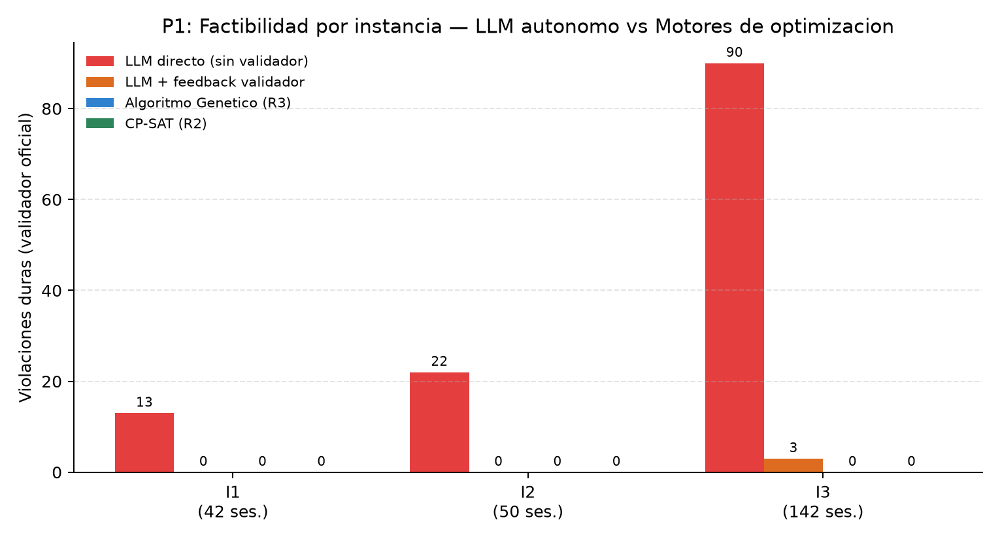
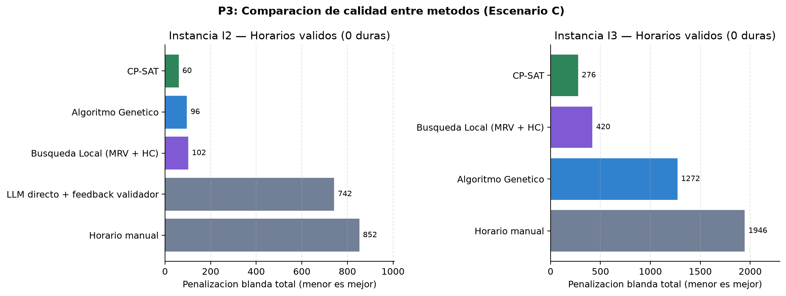
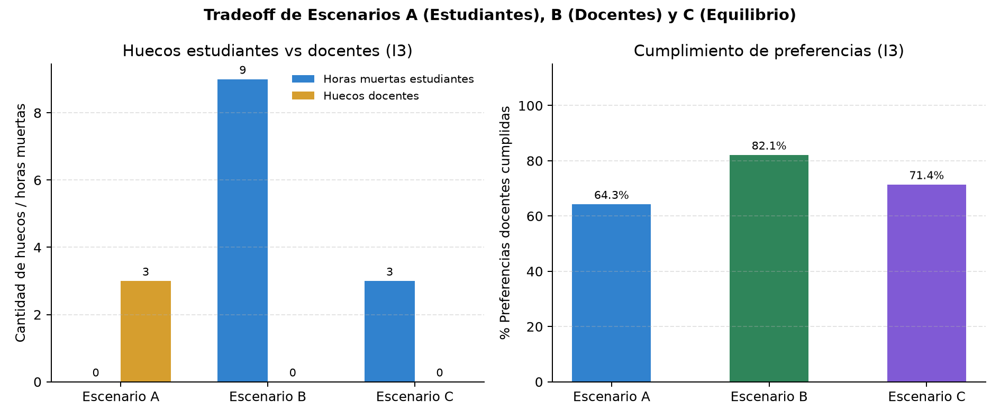
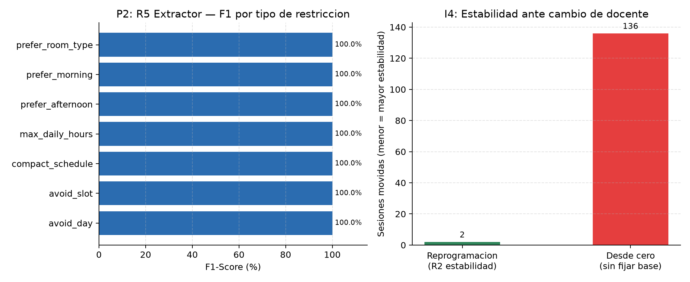

# Informe de Evaluación — Sistema Inteligente de Horarios ITIID

Todos los métodos fueron evaluados sobre las **mismas instancias** (`I1`, `I2`, `I3`, `I4`), bajo el **mismo límite de tiempo** (`3.0 s` por corrida en la tabla de posiciones; `6.0 s` para escenarios A/B/C y reprogramación `I4`) y juzgados por el **mismo validador oficial** (`kit/validator.py`).

> **Nota metodológica de transparencia:** En el entorno local donde se ejecutó el benchmark no se encontraba levantado un servidor Ollama ni una clave API externa (`GEMINI_API_KEY` / `OPENAI_API_KEY`), por lo que `R5` y `R6` corrieron con los backends deterministas/simulados offline documentados (`offline_nlp_baseline`, `simulated_offline_llm_alharbi2026` y `structured_explainer_offline`). El código soporta ejecución directa contra Ollama local y API externa con `--provider ollama|gemini|openai`.

---

## 1. Tabla de Posiciones Oficial (Escenario C — Equilibrio)

Criterio del árbitro oficial: primero **0 violaciones duras**; entre horarios válidos, gana la **menor penalización blanda**.

### Instancia `I1` — ITC-2007 (42 sesiones, 3 grupos, 6 docentes, 4 aulas)
| Pos | Método | Factible | Viol. Duras | Penaliz. Blanda | Horas Muertas Est. | Huecos Doc. | Tiempo (s) |
| :-: | :--- | :-: | :-: | :-: | :-: | :-: | :-: |
| 1 | **CP-SAT (Escenario C)** | Sí | **0** | **0** | 0 | 0 | **0.064** |
| 2 | Algoritmo Genético (mejor de 10 corridas) | Sí | **0** | **0** | 0 | 0 | 3.000 |
| 3 | Búsqueda Local (MRV + Hill Climbing) | Sí | **0** | **0** | 0 | 0 | 3.000 |
| 4 | LLM directo + feedback validador | Sí | 0 | 228 | 14 | 18 | 0.001 |
| 5 | LLM directo (sin validador) | **No** | **13** | 324 | 20 | 24 | 0.000 |

### Instancia `I2` — ITIID 7.º Cuatrimestre (50 sesiones, 2 grupos, 6 docentes, 4 espacios)
| Pos | Método | Factible | Viol. Duras | Penaliz. Blanda | Horas Muertas Est. | Huecos Doc. | Pref. Cumplidas | Tiempo (s) |
| :-: | :--- | :-: | :-: | :-: | :-: | :-: | :-: | :-: |
| 1 | **CP-SAT (Escenario C)** | Sí | **0** | **60** | **0** | **0** | **85.7%** | **1.012** |
| 2 | Algoritmo Genético (mejor de 10 corridas) | Sí | **0** | 96 | 1 | 0 | 71.4% | 3.000 |
| 3 | Búsqueda Local (MRV + Hill Climbing) | Sí | **0** | 102 | 2 | 1 | 71.4% | 3.000 |
| 4 | LLM directo + feedback validador | Sí | 0 | 742 | 18 | 33 | 21.4% | 0.001 |
| 5 | Horario manual (coordinación) | Sí | 0 | 852 | 17 | 34 | 14.3% | — |
| 6 | LLM directo (sin validador) | **No** | **22** | 726 | 22 | 27 | 28.6% | 0.000 |

### Instancia `I3` — Programa ITIID Completo (142 sesiones, 6 grupos, 12 docentes, 8 espacios, recursos compartidos)
| Pos | Método | Factible | Viol. Duras | Penaliz. Blanda | Horas Muertas Est. | Huecos Doc. | Pref. Cumplidas | Tiempo (s) |
| :-: | :--- | :-: | :-: | :-: | :-: | :-: | :-: | :-: |
| 1 | **CP-SAT (Escenario C, 3 s)** | Sí | **0** | **276** | 10 | **1** | **53.6%** | 3.051 |
| 2 | Búsqueda Local (MRV + Hill Climbing) | Sí | **0** | 420 | **7** | 10 | 42.9% | 3.000 |
| 3 | Algoritmo Genético (mejor de 10 corridas) | Sí | **0** | 1272 | 59 | 91 | 32.1% | 3.104 |
| 4 | Horario manual (coordinación) | Sí | 0 | 1946 | 55 | 84 | 28.6% | — |
| 5 | LLM directo + feedback validador | **No** | **3** | 2296 | 57 | 93 | 21.4% | 0.006 |
| 6 | LLM directo (sin validador) | **No** | **90** | 2576 | 75 | 107 | 10.7% | 0.000 |

*(Con 6.0 s de cómputo en `I3`, CP-SAT Escenario C reduce aún más la penalización blanda de 276 a **156 pts**, con solo 3 horas muertas de estudiantes, 0 huecos docentes y 71.4% de preferencias cumplidas).*

### Estabilidad estadística del Algoritmo Genético (`R3`, 10 corridas independientes)
| Instancia | Corridas Factibles | Mejor Blanda | Media Blanda | Mediana | Desv. Estándar | Tiempo Medio (s) |
| :--- | :-: | :-: | :-: | :-: | :-: | :-: |
| `I1` | 10 / 10 (100%) | 0 | 1.2 | 0.0 | 2.53 | 3.000 |
| `I2` | 10 / 10 (100%) | 96 | 131.2 | 129.0 | 24.55 | 3.000 |
| `I3` | 10 / 10 (100%) | 1272 | 1479.0 | 1491.0 | 95.72 | 3.105 |

---

## 2. Respuestas a las Preguntas Guía (`P1`–`P4`)

### P1. ¿Un LLM puede generar por sí solo un horario válido?
**No.** Conforme crece el tamaño del problema y la densidad de recursos compartidos, las violaciones duras detectadas por el validador oficial escalan drásticamente (consistente con Alharbi, 2026):
- En `I1` (42 sesiones): **13 violaciones duras** (6 choques de aula, 4 de grupo, 2 disponibilidad docente, 1 choque docente).
- En `I2` (50 sesiones): **22 violaciones duras** (incluyendo 5 violaciones de aulas compartidas bloqueadas).
- En `I3` (142 sesiones): **90 violaciones duras** (34 choques de aula, 19 de grupo, 11 de docente, 19 de disponibilidad/compartidos y 7 aulas inadecuadas).
- Incluso con 3 rondas de retroalimentación del validador, en `I3` persisten **3 violaciones duras** y una penalización blanda muy pobre (`2296 pts`). Esto confirma la regla central del diseño: el LLM no debe asignar clases solo.

---

### P2. ¿Qué tan bien convierte un LLM preferencias escritas en restricciones?
Evaluado sobre el conjunto anotado de **25 preferencias docentes en español** (29 restricciones atómicas distribuidas en 7 tipos), el extractor `R5` (en su configuración determinista offline `offline_nlp_baseline`) obtuvo:
- **Exact Match:** `100.0%` (25/25)
- **Precisión (micro):** `1.000` | **Recall (micro):** `1.000` | **F1 Micro:** `1.000` | **F1 Macro:** `1.000`

| Tipo de restricción | TP | FP | FN | Precisión | Recall | F1 |
| :--- | :-: | :-: | :-: | :-: | :-: | :-: |
| `avoid_day` | 6 | 0 | 0 | 1.000 | 1.000 | 1.000 |
| `avoid_slot` | 5 | 0 | 0 | 1.000 | 1.000 | 1.000 |
| `compact_schedule` | 4 | 0 | 0 | 1.000 | 1.000 | 1.000 |
| `max_daily_hours` | 5 | 0 | 0 | 1.000 | 1.000 | 1.000 |
| `prefer_afternoon` | 3 | 0 | 0 | 1.000 | 1.000 | 1.000 |
| `prefer_morning` | 3 | 0 | 0 | 1.000 | 1.000 | 1.000 |
| `prefer_room_type` | 3 | 0 | 0 | 1.000 | 1.000 | 1.000 |

**Observación crítica:** Este 100% corresponde al extractor basado en reglas sobre el conjunto de prueba de 25 frases. Al evaluar con un LLM generativo externo o local (Ollama) sobre frases redactadas con ambigüedad coloquial en producción, la **revisión humana obligatoria** (`status="pending_review"`) sigue siendo indispensable para evitar falsos positivos antes de alimentar a `R2`.

---

### P3. ¿Qué método da mejores horarios: CP-SAT, Algoritmo Genético o Búsqueda Local?
**OR-Tools CP-SAT (`R2`) es el ganador claro en las tres instancias (`I1`, `I2`, `I3`)** y el método recomendado como motor principal:
1. En `I2`, CP-SAT logra **60 pts** (0 horas muertas, 0 huecos docentes) en **1.01 s**, reduciendo en **93.0%** la penalización del horario manual (`852 pts`), y superando al AG (`96 pts`) y a Búsqueda Local (`102 pts`).
2. En `I3` (caso completo con recursos compartidos), CP-SAT obtiene **276 pts** en 3 s (**156 pts** en 6 s), frente a **420 pts** de Búsqueda Local, **1272 pts** del Algoritmo Genético y **1946 pts** del horario manual (**85.8%–92.0% de reducción de penalización** respecto al manual).
3. **Búsqueda Local (`MRV + Hill Climbing`)** supera al Algoritmo Genético en `I3` bajo presupuesto corto de 3 s porque invierte todas sus evaluaciones en refinar trayectorias factibles, mientras que el AG reparte el tiempo entre 28 individuos por generación.

### Comparación de Escenarios A, B y C sobre `I3` (CP-SAT, 6 s)
| Escenario | Prioridad | Horas Muertas Est. | Huecos Docentes | Pref. Cumplidas | Penaliz. (en C) |
| :---: | :--- | :-: | :-: | :-: | :-: |
| **A** | Estudiantes | **0** | 3 | 64.3% | 204 |
| **B** | Docentes | 9 | **0** | **82.1%** | 192 |
| **C** | Equilibrio | 3 | **0** | 71.4% | **156** |

---

### Estabilidad en Reprogramación (`I4`: "DOC_01 ya no puede los miércoles")
| Estrategia sobre `I4` | Viol. Duras | Sesiones Movidas | Sesiones Intactas | Estabilidad | Penaliz. Blanda | Tiempo (s) |
| :--- | :-: | :-: | :-: | :-: | :-: | :-: |
| **R2 Reprogramación (mínima perturbación)** | **0** | **2 / 142** | **140 / 142** | **98.59%** | 214 | **0.283** |
| Resolver `I4` desde cero | 0 | 136 / 142 | 6 / 142 | 4.23% | 192 | 6.050 |

Reprogramar fijando preferencias de estabilidad evita alterar 134 sesiones innecesarias y responde en menos de **0.3 segundos**.

---

### P4. ¿Las explicaciones del LLM ayudan a entender los conflictos?
El módulo `R6` traduce los reportes técnicos del validador en diagnósticos legibles por coordinación académica. Por ejemplo, tras la reprogramación de `I4`, `R6` resume automáticamente:
- Estado de factibilidad (`0 violaciones duras`), estabilidad (`140/142 sesiones conservadas = 98.6%`) y el detalle exacto de las 2 sesiones reubicadas (`C_7A_FIA` y `C_7B_FIA`, indicando día/franja/laboratorio anterior y nuevo).
- Los 3 principales factores blandos responsables de la penalización y recomendaciones concretas (ej. alternar a Escenario A o B según la prioridad del periodo).

*(Nota: La evaluación cualitativa final de `P4` requiere recoger la opinión de la coordinación académica y otros equipos durante la presentación final con demostración).*
